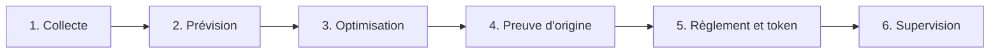

# ☀️ SolarSouk-STEG — Rapport d’avancement, Semaines 1 et 2

> **Projet DS2 · SOA · Track 7 · 3 BI 1 · ISGT**
> Plateforme de micro-réseau solaire pour fermes et PME en zones arides.

| Information | Détail |
|---|---|
| **Projet** | SolarSouk-STEG (Track 7), plateforme de micro-réseau solaire pour fermes et PME |
| **Cours** | SOA — DS2, Track 7 |
| **Classe** | 3 BI 1 · ISGT |
| **Période couverte** | Semaines 1 et 2 (sur 4) |
| **Équipe** | Ali Lajili (Rôle 1) · Mohamed Mahmoudi (Rôle 2) · Adem Ouerfelli (Rôle 3) · Mouin Ziadi (Rôle 4) · Mahdi Hamrouni (Rôle 5) |
| **Énoncé officiel** | DS2 2026–2027 « TuniSovereign-AI », Chaouki Bayoudhi (ISG Tunis) |
| **Remise et soutenances** | Fin de la Semaine 4 ; soutenances individuelles en classe ensuite |

## 🆕 Avancement de la Semaine 2

**Légende :** ✅ fait · 🟡 partiel · ⬜ à faire

**Période :** *[À COMPLÉTER : dates de la Semaine 2]*

> Ce document se lit en deux parties. La **Partie A** (cette section) présente l’avancement de la Semaine 2. La **Partie B** (sommaire ci-dessous) reprend le rapport complet : l’état de la Semaine 1 et, signalés « Semaine 2 », les compléments techniques ajoutés depuis.

### S2.1 Résumé de la semaine

Le **Rôle 1** a terminé la couche « données et détection » : les anomalies de nœud repérées par l’IsolationForest sont enregistrées en base avec un type et une sévérité (**202 événements**, en plus des 42 surcharges de feeder, soit **244 événements**), la performance du modèle est mesurée (**F1 = 0,83**) et l’agent du Rôle 4 est déclenché automatiquement sur les incidents critiques dès qu’il existe. Ce README est mis à jour, avec le facteur d’émission sourcé et les tarifs signalés comme fictifs. Pour les **Rôles 2 à 5** : *[À COMPLÉTER : une ou deux phrases par rôle]*.

### S2.2 Tableau d’avancement par rôle

| Rôle | Fait cette semaine | En cours | Prévu en Semaine 3 |
|---|---|---|---|
| **1 — Ali** | Détection d’anomalies complète : 202 anomalies de nœud enregistrées avec type et sévérité, F1 mesuré à 0,83 ; déclenchement automatique de l’agent sur les incidents `CRITICAL` (`agent_trigger.py`) ; README ; rapport mis à jour ; travail sauvegardé dans Git | Diagrammes UML de classes et de séquence, schéma d’architecture | Test de bout en bout avec l’agent du Rôle 4 ; compléter ce README avec les parties des autres rôles ; slides ; fusion des branches dans `main` |
| **2 — Mohamed** | *[À COMPLÉTER]* | *[À COMPLÉTER]* | *[À COMPLÉTER]* |
| **3 — Adem** | *[À COMPLÉTER]* | *[À COMPLÉTER]* | *[À COMPLÉTER]* |
| **4 — Mouin** | *[À COMPLÉTER]* | *[À COMPLÉTER]* | *[À COMPLÉTER]* |
| **5 — Mahdi** | *[À COMPLÉTER]* | *[À COMPLÉTER]* | *[À COMPLÉTER]* |

### S2.3 Détail par rôle

**Rôle 1 — Ali.** Cette semaine, j’ai terminé la détection d’anomalies. Le modèle IsolationForest signale les mesures de nœud inhabituelles ; chacune est enregistrée dans `AnomalyAndForecastEvent` avec son score, son type (tension, onduleur, pompe ou batterie, déduit de règles lisibles) et sa sévérité (les 10 % les plus extrêmes sont `CRITICAL`, les 30 % suivantes `MEDIUM`, le reste `LOW`). La commande `detect_anomalies` est idempotente : la relancer ne crée pas de doublons. Sur les données simulées, elle donne 42 surcharges feeder (précision et rappel de 1,0) et 202 anomalies de nœud (précision 0,88, rappel 0,79, F1 = 0,83). J’ai ensuite écrit le module `agent_trigger.py` : il lance `run_agent` sur les incidents `CRITICAL`, une seule fois par incident (nœud ou feeder et jour), sans relancer un incident déjà traité, et sans planter tant que l’agent n’existe pas (§ 4.12). Fichiers : `ml_anomaly.py` et `detect_anomalies.py` (modifiés), `agent_trigger.py` et `README.md` (nouveaux). Difficultés et choix : `models.py` ne propose que quatre types d’anomalie pour les nœuds, d’où des règles de classement ; le grand nombre de `PUMP_MISALIGNED` vient des pompes de Tozeur qui tournent le soir pendant la surcharge (§ 4.7). Prochaines étapes : diagrammes, test avec l’agent du Rôle 4, slides.

**Rôle 2 — Mohamed.** *[À RÉDIGER : ce qui a été fait (facturation, endpoints de règlement et de planning, point d’accès darija, serveur MCP), fichiers modifiés ou créés, tests réalisés, difficultés, prochaines étapes.]*

**Rôle 3 — Adem.** *[À RÉDIGER : ce qui a été fait (GraphQL, CSRF, dashboard Streamlit, workflow n8n), fichiers modifiés ou créés, tests réalisés, difficultés, prochaines étapes.]*

**Rôle 4 — Mouin.** *[À RÉDIGER : ce qui a été fait (agent LangGraph, optimiseur de pompes, skill darija, stub de `optimize_pump_schedule`), fichiers modifiés ou créés, tests réalisés, difficultés, prochaines étapes. Rappel : `run_agent` doit retourner l’identifiant de l’`AgentLoopExecution` créée.]*

**Rôle 5 — Mahdi.** *[À RÉDIGER : ce qui a été fait (contrat Solidity, preuve ZK, crédits carbone, stubs de `prove_green_origin` et `settle_on_chain`), fichiers modifiés ou créés, tests réalisés, difficultés, prochaines étapes.]*

### S2.4 Résultats de contrôle (Rôle 1)

| Contrôle | Résultat obtenu |
|---|---|
| Surcharges feeder (règle > 92 %) | 42 détectées ; précision 1,0, rappel 1,0 |
| Anomalies de nœud (IsolationForest) | 202 détectées ; précision 0,88, rappel 0,79, F1 = 0,83 |
| Répartition par type | `PUMP_MISALIGNED` 130 · `INVERTER_FAILURE` 29 · `SOC_INCONSISTENT` 28 · `VOLTAGE_OUT_OF_RANGE` 15 |
| Répartition par sévérité (nœuds) | `LOW` 121 · `MEDIUM` 61 · `CRITICAL` 20 (plus 42 `CRITICAL` de surcharge feeder) |
| Total d’événements en base | 244 (42 + 202) |
| Déclenchement de l’agent | *[À COMPLÉTER : coller le message affiché par la commande. Tant que `run_agent` n’existe pas, le message attendu indique « Agent non connecté (Rôle 4) » et le nombre d’incidents `CRITICAL` en attente.]* |

Commandes de contrôle : [Annexe C, étape 4](#annexe-c--reproduire-les-résultats). *[À COMPLÉTER : insérer les captures d’écran.]*

### S2.5 Couverture du barème (mise à jour)

| Critère | Points | Fin de la Semaine 1 | Fin de la Semaine 2 |
|---|---|---|---|
| Backend REST + GraphQL + gRPC | 3,5 | 🟡 gRPC fait ; REST et GraphQL à réécrire | 🟡 gRPC fait, avec déclenchement automatique de l’agent ; REST : *[À COMPLÉTER Rôle 2]* ; GraphQL : *[À COMPLÉTER Rôle 3]* |
| Modèles, UML, authentification, rôles | 2,5 | 🟡 Modèles et comptes faits ; UML, JWT et permissions à faire | 🟡 Modèles et comptes faits ; UML de classes et de séquence : en cours (Rôle 1) ; JWT et permissions : *[À COMPLÉTER Rôle 2]* |
| Simulateur + ML | 2 | 🟡 Fait ; évaluation à documenter | ✅ Fait ; évaluation documentée (IsolationForest F1 = 0,83, règle feeder F1 = 1,0) ; anomalies enregistrées avec type et sévérité |
| Agent, MCP, Skills | 4 | 🟡 1 skill sur 3 faite (prévision) ; le reste à faire | 🟡 Skill de prévision faite ; déclenchement automatique de l’agent prêt ; agent, MCP et optimiseur : *[À COMPLÉTER Rôles 2 et 4]* |
| Blockchain + ZK | 1,5 | ⬜ À faire | *[À COMPLÉTER Rôle 5]* |
| Dashboard, n8n, Docker, README | 1,5 | 🟡 Docker fait ; le reste à faire | 🟡 Docker et README faits ; dashboard et n8n : *[À COMPLÉTER Rôle 3]* |
| Défense orale individuelle | 5 | 🟡 Préparation en continu | 🟡 Questions de défense du Rôle 1 ajoutées (§ 8) ; journaux de rôle à tenir à jour par chacun |

### S2.6 Décisions, risques et dépendances

- **Facteur d’émission du réseau tunisien :** valeur proposée **0,468 kgCO₂/kWh** (moyenne IEA relevée dans le rapport EPIC Deploy sur la Tunisie, 2026) ; alternative 0,483 (Electricity Maps 2025). À revérifier à la source IEA avant la remise finale, à valider par l’équipe, puis à communiquer au Rôle 5 (lecture dans `.env`).
- **Seuil de 92 % :** il vient de l’énoncé (tableau des seuils, Track 7) ; aucune norme externe ne le fixe (§ 4.7).
- **Dépendance :** l’agent du Rôle 4 doit exposer `run_agent(anomaly_id)` et retourner l’identifiant de l’`AgentLoopExecution` créée ; c’est ce qu’attendent le serveur gRPC et `agent_trigger.py`.
- *[À COMPLÉTER : autres risques, blocages et décisions de la semaine, pour les Rôles 2 à 5.]*

### S2.7 Prévu pour la Semaine 3

Voir aussi le planning du [§ 7.3](#73-planning-peut-changer). **Rôle 1 :** diagrammes UML et d’architecture terminés, test de bout en bout avec l’agent, README complété avec les parties des autres rôles, slides. **Rôles 2 à 5 :** *[À COMPLÉTER]*.

---

# Partie B — Rapport complet

## 📑 Sommaire

**Partie A — Avancement de la Semaine 2** (juste au-dessus) : [aller à la section](#-avancement-de-la-semaine-2)

**Partie B — Rapport complet** (état de la Semaine 1, avec les compléments marqués « Semaine 2 ») :

1. [Résumé](#1-résumé)
2. [Comprendre le projet](#2-comprendre-le-projet)
3. [Organisation de l’équipe](#3-organisation-de-léquipe)
4. [Choix de conception et justifications](#4-choix-de-conception-et-justifications)
5. [Réalisations de la Semaine 1](#5-réalisations-de-la-semaine-1)
6. [Limites connues et risques](#6-limites-connues-et-risques)
7. [Reste à faire (Semaines 2 à 4)](#7-reste-à-faire-semaines-2-à-4)
8. [Préparation à la défense orale](#8-préparation-à-la-défense-orale)
9. [Annexes](#annexes)

---

## 1. Résumé

> Ce résumé décrit l’état de la **Semaine 1**. L’avancement de la **Semaine 2** est présenté en tête de document.

SolarSouk-STEG est une plateforme de micro-réseau solaire destinée à des fermes et PME de quatre gouvernorats : **Tozeur, Kébili, Tataouine et Sfax**. Elle poursuit trois objectifs :

- éviter les **coupures d’été** causées par le pompage d’irrigation ;
- régler automatiquement l’énergie échangée avec le réseau de la STEG (le **net-metering**) ;
- produire des **crédits carbone vérifiables**.

**Objectif de la Semaine 1 :** construire le socle sur lequel les cinq rôles vont travailler. Ce socle est en place.

| Livrable | Résultat |
|---|---|
| Base de données PostgreSQL | 12 modèles, 2 migrations |
| Données de démonstration | 4 feeders, 4 coopératives, 3 tarifs, 7 comptes de test, 10 nœuds solaires |
| Ingestion de mesures (serveur gRPC) | 33 600 mesures simulées sur 7 jours |
| Détection de surcharge | 42 événements sur le feeder de Tozeur |
| Détection d’anomalies par ML | F1 ≈ 0,85 (sur données simulées) |
| Prévision de pointe de charge | `forecast_peak_load` opérationnelle |
| Environnement Docker | Démarrage en quelques commandes sur chaque ordinateur de l’équipe |
| Contrats d’interface | Signatures écrites entre les cinq rôles, pour un développement autonome |

**Reste à construire :** les couches visibles et intelligentes — API REST et authentification, GraphQL et tableau de bord, agent, serveur MCP, optimisation des pompes, preuve ZK et blockchain.

---

## 2. Comprendre le projet

### 2.1 Le problème

En été, les fermes des zones arides démarrent leurs pompes d’irrigation aux mêmes heures. Le **feeder** (le départ électrique qui alimente un groupe de clients) dépasse alors sa capacité et la coupure survient. Dans nos données simulées, la pointe de Tozeur a lieu chaque jour entre **19 h et 20 h 15, heure de Tunis** (soit 18 h – 19 h 15 UTC).

Trois manques sont visés :

1. des coupures dues à la pointe du soir ;
2. aucun règlement automatique du net-metering : le producteur injecte son surplus dans le réseau, et il faut comparer, à la fin de chaque période, les kWh importés et exportés ;
3. aucun crédit carbone dont l’origine « énergie verte » soit vérifiée.

> **En clair.** Imaginons une route à capacité limitée : si tous les camions partent en même temps, c’est l’embouteillage. La solution est d’étaler les départs vers le milieu de journée, quand le soleil produit le plus, puis de comptabiliser proprement ce qui a été échangé.

### 2.2 La solution : une chaîne en six étapes



| Étape | Ce qui se passe | Image simple | Où dans le projet |
|---|---|---|---|
| 1. Collecte | Les onduleurs envoient leurs mesures | Un relevé de compteur automatique | Serveur gRPC, simulateur |
| 2. Prévision | Estimer la charge et la production des prochaines heures | La météo du réseau électrique | `forecast_peak_load` |
| 3. Optimisation | Décaler les démarrages de pompes vers 10 h–15 h | Un chef de chantier qui étale les départs | Skill d’optimisation, serveur MCP |
| 4. Preuve d’origine | Prouver que les kWh « verts » respectent le quota sans révéler le chiffre exact | Prouver qu’on est majeur sans montrer sa carte d’identité | Skill ZK |
| 5. Règlement et token | Enregistrer le règlement et émettre un token carbone sur la blockchain | Un reçu infalsifiable | Contrat Solidity, web3 |
| 6. Supervision | Voir, auditer, être alerté | Un tableau de bord | REST, GraphQL, temps réel (WebSockets/SSE), Streamlit, n8n |

**L’agent.** Un agent **LangGraph** orchestre les étapes 2 à 5. À chaque passage, il vérifie deux garde-fous :

- la charge du feeder reste **sous 92 %** de sa capacité ;
- le **quota** de la coopérative est respecté.

Si l’un échoue, il réessaie avec des paramètres ajustés (**3 tours maximum**), puis passe le dossier à un auditeur humain (statut `ESCALATED`). L’agent doit fonctionner **sans clé API payante**, tout en intégrant un modèle de langage : **Groq** (offre gratuite) ou **Ollama** (local) pilote le raisonnement (plan, choix des outils, explication finale), selon le schéma **ReAct + Plan-and-Solve**. Les contrôles critiques (seuil de 92 %, quota) restent **déterministes**, et l’état de l’agent est sauvegardé à chaque étape dans PostgreSQL (*checkpointing*).

**Entrée en darija.** Une commande en texte (ou en audio, en option) en darija peut aussi déclencher l’agent, par le point d’accès `/api/v1/darja-intent/` : une skill d’analyse la transforme en intention structurée, utilisée comme nœud d’entrée de l’agent.

### 2.3 Les skills et le serveur MCP

Une **skill** est une fonction spécialisée que l’agent peut appeler. Les trois premières sont imposées par l’énoncé ; la quatrième répond au critère d’analyse du langage (darija).

| Skill | Fonction correspondante | Responsable | État |
|---|---|---|---|
| `IrradianceAndLoadForecasterSkill` | `forecast_peak_load` | Rôle 1 (Ali) | ✅ Fait (version simple) |
| `PumpPeakShavingOptimizerSkill` | `optimize_pump_schedule` | Rôle 4 (Mouin) | ⬜ À faire |
| `ZKGreenEnergyOriginProverSkill` | `prove_green_origin`, `settle_on_chain` | Rôle 5 (Mahdi) | ⬜ À faire |
| `DarjaDialectParserSkill` (ajoutée) | Analyse d’une commande en texte ou en darija, point d’entrée de l’agent | Rôle 4 (Mouin) | ⬜ À faire |

Le serveur **SolarGridMCP** (Rôle 2, Mohamed), construit avec FastMCP (SDK Python officiel `mcp`), expose six fonctions à l’agent. L’énoncé exige au moins 2 ressources (données en lecture) et 2 outils (actions ou calculs) :

- **Ressources :** `get_feeder_status`, `get_cooperative_quota`
- **Outils :** `forecast_peak_load`, `optimize_pump_schedule`, `prove_green_origin`, `settle_on_chain`

> MCP est un protocole standard qui permet à un agent d’appeler des outils, comme une prise normalisée.

### 2.4 Périmètre simulé

| Gouvernorat | Feeder (capacité) | Nœuds solaires |
|---|---|---|
| Tozeur | Feeder-TOZ-01 (45 kW) | TOZ-001 à TOZ-003 |
| Kébili | Feeder-KEB-01 (47 kW) | KEB-001 à KEB-003 |
| Tataouine | Feeder-TAT-01 (29 kW) | TAT-001, TAT-002 |
| Sfax | Feeder-SFX-01 (36 kW) | SFX-001, SFX-002 |

---

## 3. Organisation de l’équipe

| Rôle | Membre | Domaine |
|---|---|---|
| 1 | Ali | Données, ML, infrastructure, documentation ; seul à modifier `models.py` et `migrations/` |
| 2 | Mohamed | API REST, authentification JWT, permissions par rôle, facturation, serveur MCP |
| 3 | Adem | GraphQL, tableau de bord Streamlit, workflow d’alerte n8n, flux temps réel (WebSockets/SSE) |
| 4 | Mouin | Agent LangGraph, optimiseur de planning des pompes, skill d’analyse du darija |
| 5 | Mahdi | Contrat Solidity, preuve ZK, crédits carbone |

**Règles de travail adoptées :**

- **Un seul propriétaire par fichier** : deux personnes ne modifient jamais le même fichier, ce qui évite les conflits.
- **Git** : une branche par personne et une branche commune `testmain` (tests avant fusion dans `main`) ; petits commits ; mise à jour depuis `main` avant chaque envoi.
- **Aucun secret dans le dépôt** : mots de passe et clés restent dans le fichier `.env`, jamais commité.
- **Annonce préalable** : tout changement de modèle ou de signature de fonction est annoncé au groupe avant d’être codé.
- **Un journal par rôle** (`docs/notes_roleN.md`) : à chaque commit, on note ce qui a été fait et pourquoi, pour préparer la défense orale individuelle.

---

## 4. Choix de conception et justifications

### 4.1 Architecture en couches

Le projet suit une architecture en couches, du centre vers l’extérieur. Chaque couche ne communique avec les autres que par des interfaces écrites (§ 4.10), ce qui permet aux cinq rôles de travailler en parallèle.

| Couche | Contenu | Rôles |
|---|---|---|
| 1. Données | PostgreSQL, modèles Django 6 | 1 |
| 2. Services de données | Simulateur, serveur gRPC, détection d’anomalies, prévision | 1 |
| 3. Logique intelligente | Agent, serveur MCP, optimiseur de pompes, preuve ZK, blockchain | 2, 4, 5 |
| 4. Interfaces de consultation | API REST, GraphQL, flux temps réel (WebSockets/SSE), tableau de bord, n8n | 2, 3 |

### 4.2 Conventions de données

| Convention | Pourquoi ce choix |
|---|---|
| **Argent en millimes, en nombres entiers** | Le dinar se divise en 1 000 millimes. Les nombres à virgule font des erreurs d’arrondi (en informatique, 0,1 + 0,2 ne donne pas exactement 0,3) : inacceptable sur des factures. |
| **Horodatages en UTC** | Une seule heure de référence évite toute confusion de fuseau ou de changement d’heure. La Tunisie étant à UTC+1, 19 h locale = 18 h UTC. |
| **`GRID_NET_KW` positif = import, négatif = export** | Un seul champ dit si un nœud consomme ou injecte. La charge d’un feeder est la somme des `GRID_NET_KW` de ses nœuds. |
| **Le ML ne lit jamais `is_injected_anomaly`** | Cette étiquette marque les anomalies ajoutées volontairement par le simulateur ; elle ne sert qu’à évaluer le modèle, comme le corrigé d’un examen qu’on ne montre pas à l’élève pendant l’épreuve. |
| **Aucun secret en dur** | Tout ce qui est sensible vit dans `.env` et n’est jamais publié. |

### 4.3 Modèle de données

Le contrat de données est le couple `docs/models.md` (description) et `models.py` (code). La migration **0001** a créé 9 modèles, la migration **0002** en ajoute 3 : la base compte **12 modèles**.

| Modèle | Rôle dans le système | Migration |
|---|---|---|
| `StakeholderUser` | Utilisateur, avec l’un des 4 rôles d’accès | 0001 |
| `Feeder` | Départ électrique et sa capacité (kW) | 0001 |
| `CooperativeUnit` | Coopérative, avec son quota | 0001 |
| `ResourceNodePlot` | Nœud solaire (une parcelle équipée) | 0001 |
| `Tariff` | Tarif d’électricité (3 tarifs) | 0001 |
| `TelemetryReading` | Une mesure d’un nœud à un instant donné | 0001 |
| `AnomalyAndForecastEvent` | Anomalie détectée ou prévision de déficit | 0001 |
| `AgentLoopExecution` | Trace d’un passage de l’agent (statut, outils appelés, recommandation) | 0001 |
| `OnChainZKReceipt` | Reçu d’une transaction blockchain | 0001 |
| `PumpSchedule` | Planning de pompes proposé par l’agent, lié à un nœud et à une exécution de l’agent | 0002 |
| `NetMeteringSettlement` | Règlement d’un nœud sur une période : kWh importés et exportés, montants en millimes | 0002 |
| `CarbonCredit` | Crédit carbone lié à un règlement : kWh verts, kg de CO₂ évités, facteur d’émission utilisé | 0002 |

**Pourquoi trois modèles dès la migration 0002 ?** Ils décrivent la fin de la chaîne (optimisation, règlement, carbone), dont dépendent les Rôles 2 à 5 : chacun connaît ainsi sa cible dès la Semaine 1.

> **En clair.** Une migration est le journal des modifications de la structure de la base : elle permet à chaque ordinateur de reconstruire la même base à l’identique.

### 4.4 Utilisateurs et rôles d’accès

Quatre rôles d’accès et sept comptes de test, créés automatiquement. Le mot de passe de développement est défini dans l’environnement de l’équipe ; il n’est volontairement pas reproduit ici.

| Rôle d’accès | Droit principal | Comptes de test |
|---|---|---|
| `COOP_MEMBER` | Ne voit que ses propres nœuds et sa coopérative | `coop_tozeur`, `coop_kebili`, `coop_tataouine`, `coop_sfax` |
| `REGIONAL_AUDITOR` | Lit tout son gouvernorat | `auditeur_tozeur` |
| `NATIONAL_ADMIN` | Accès à tout, y compris l’administration Django | `admin_national` |
| `AGENT_SERVICE` | Compte technique de l’agent IA et du serveur MCP (écrit événements, plannings, règlements) | `agent_service` |

**Pourquoi ces quatre rôles ?** Ils reflètent la réalité : un agriculteur ne doit pas voir les données de son voisin (confidentialité), un auditeur contrôle sa région, un administrateur gère l’ensemble, et l’agent a un compte à part pour que ses actions soient traçables. La mise en œuvre de ces droits dans l’API (JWT, tests 200/403) reste à faire (Rôle 2).

### 4.5 Ingestion par gRPC

Les mesures arrivent par un serveur **gRPC**, défini par le fichier `protos/tunisovereign.proto`. Ce choix convient à un flux continu de petits messages et impose un format strict : un onduleur qui envoie un message mal formé est refusé. Le serveur enregistre chaque mesure en `TelemetryReading` et confirme le nombre de mesures acceptées.

Il expose aussi une méthode `TriggerUrgentAudit` qui appelle l’agent du Rôle 4 (`run_agent`). Tant que l’agent n’existe pas, elle répond `AGENT_NOT_CONNECTED`, ce qui montre que le branchement est prêt.

### 4.6 Simulateur de données (7 jours)

Nous n’avons pas accès aux mesures réelles des onduleurs : le simulateur (`simulator/tunisian_simulator.py`) génère donc des données plausibles, soit environ **4 800 mesures par jour** pour 10 nœuds, dont une quarantaine portent volontairement une anomalie injectée (pour pouvoir évaluer le ML). Il reproduit le phénomène étudié : chaque jour, le feeder de Tozeur dépasse 92 % de sa capacité vers 19 h–20 h 15, tandis que les autres restent sous environ 73 %.

La commande est **rejouable** : elle efface puis régénère les données, ce qui rend les démonstrations reproductibles.

### 4.7 Détection d’anomalies : deux méthodes complémentaires

| Méthode | Principe | Résultat |
|---|---|---|
| **Règle de surcharge** | Un feeder dont la charge dépasse 92 % de sa capacité (seuil indiqué par l’énoncé pour le Track 7) déclenche un événement `FEEDER_OVERLOAD` de sévérité `CRITICAL`. Transparente et facile à justifier. | 42 événements sur le feeder de Tozeur ; précision et rappel de 1,0 (Semaine 2) |
| **Modèle IsolationForest** (scikit-learn) | Repère les mesures de nœud « inhabituelles » sans qu’on lui dise ce qu’est une anomalie. | F1 ≈ 0,85 estimé en Semaine 1 ; **mesuré en Semaine 2 : F1 = 0,83** (précision 0,88, rappel 0,79), voir ci-dessous et § 6 |

> **En clair.** L’IsolationForest fonctionne comme un jeu de « Où est Charlie ? » : un point atypique est isolé en très peu de questions, un point normal en demande beaucoup. Le score F1 (de 0 à 1) mesure à la fois les anomalies trouvées et le peu de fausses alertes.

**Pourquoi deux méthodes ?** La règle couvre le risque métier central (la surcharge) de façon explicable ; le ML couvre les comportements anormaux que personne n’avait prévus.

**Compléments de la Semaine 2.**

- **Évaluation mesurée.** Sur 6 720 lignes « nœud × instant », le simulateur a injecté 224 anomalies ; l’IsolationForest en signale 202, dont 177 correctes (25 fausses alertes, 47 anomalies manquées) : précision 0,88, rappel 0,79, **F1 = 0,83**. La règle de surcharge retrouve les 42 instants injectés, sans fausse alerte.
- **Enregistrement en base.** La commande `detect_anomalies` enregistre chaque anomalie de nœud dans `AnomalyAndForecastEvent` avec le nœud, l’horodatage, le score de l’IsolationForest et la version du modèle (`isoforest-v1`). Elle est **idempotente** : la relancer ne crée pas de doublons. Résultat : **244 événements**, dont 42 surcharges feeder (`rule-overload-v1`) et 202 anomalies de nœud.
- **Type attribué.** Le modèle dit seulement qu’une mesure est inhabituelle ; le type est ensuite donné par des règles lisibles :

| Type | Règle |
|---|---|
| `VOLTAGE_OUT_OF_RANGE` | Tension hors de 220 V ± 6 % |
| `SOC_INCONSISTENT` | Batterie sous 10 % (le simulateur ne descend jamais plus bas) |
| `INVERTER_FAILURE` | Production quasi nulle entre 10 h et 15 h |
| `PUMP_MISALIGNED` | Pompe en marche hors de la fenêtre solaire 10 h–15 h |

  Si aucune règle ne s’applique, la mesure la plus éloignée de la normale décide.
- **Sévérité.** Parmi les anomalies de nœud, les 10 % les plus extrêmes (score le plus bas) sont `CRITICAL`, les 30 % suivantes `MEDIUM`, le reste `LOW`. Toutes les surcharges feeder sont `CRITICAL`.

| Répartition (anomalies de nœud) | Nombre |
|---|---|
| Par type | `PUMP_MISALIGNED` 130 · `INVERTER_FAILURE` 29 · `SOC_INCONSISTENT` 28 · `VOLTAGE_OUT_OF_RANGE` 15 |
| Par sévérité | `LOW` 121 · `MEDIUM` 61 · `CRITICAL` 20 |

> **Pourquoi tant de `PUMP_MISALIGNED` ?** Pendant la surcharge de Tozeur, les pompes démarrent en soirée. L’IsolationForest signale aussi ces nœuds et la règle les étiquette `PUMP_MISALIGNED`. Ce n’est pas une erreur : la pompe tourne bien hors de la fenêtre solaire.

### 4.8 Prévision de pointe de charge

La fonction `forecast_peak_load(feeder_id, horizon_hours)` calcule le profil horaire moyen des jours précédents, puis y applique un ajustement. Elle renvoie, heure par heure, la charge et la production prévues, le pic (en kW et en % de capacité) et le déficit prévu sur 24 h (en kWh). Une version provisoire (« stub ») a d’abord été publiée pour débloquer les autres rôles ; la vraie version l’a remplacée.

| Feeder | Pic prévu (% de la capacité) | Déficit prévu sur 24 h |
|---|---|---|
| Feeder-TOZ-01 | ≈ 98 % | 3,9 kWh |
| Les trois autres feeders | < 72 % | Aucun |

La prévision identifie donc bien le feeder problématique.

**Pourquoi une méthode simple ?** Elle est déterministe (même entrée, même sortie), s’exécute sans clé API, convient à une semaine d’historique et reste facile à comprendre. Une source externe (météo réelle, via n8n et l’API gratuite Open-Meteo) pourra être ajoutée ensuite (§ 4.11).

### 4.9 Environnement Docker

Docker exécute chaque composant dans un conteneur identique sur tous les ordinateurs, ce qui évite le classique « ça marche chez moi ». Notre fichier `docker-compose.yml` comprend :

| Service | Fonction | État normal |
|---|---|---|
| `db` | Base PostgreSQL | `healthy` |
| `init` | Applique les migrations et charge les données de référence, puis s’arrête | `Exited (0)` : c’est normal |
| `grpc` | Serveur d’ingestion | `healthy` |
| `simulate` | Génère les 7 jours de données, rejouable à volonté | Lancé à la demande |

D’autres services sont réservés aux autres rôles : Anvil (blockchain de test), n8n (alertes) et le tableau de bord.

Le point de départ du starter ne démarrait que la base : nous avons corrigé le Dockerfile et le fichier compose. **Règle provisoire :** toujours nommer les services, ne jamais lancer `docker compose up` seul (commandes exactes : [Annexe C](#annexe-c--reproduire-les-résultats)).

> ⚠️ **Exigence de remise :** `docker compose up` seul doit démarrer l’ensemble du projet en une commande (critère 6.2 de l’énoncé). La règle provisoire ci-dessus sera levée avant la remise.

### 4.10 Contrats d’interface et « stubs »

Les cinq rôles s’appellent mutuellement : l’agent utilise la prévision, l’optimiseur, la preuve ZK et le règlement ; le serveur MCP les expose. Nous avons donc fixé par écrit (`docs/contrats_interfaces.md`) la signature exacte de chaque fonction partagée.

| Fonction | Propriétaire | Entrée | Sortie |
|---|---|---|---|
| `forecast_peak_load` | Rôle 1 | `feeder_id`, `horizon_hours` | Charge et production par heure, pic en kW et en %, déficit 24 h |
| `optimize_pump_schedule` | Rôle 4 | `feeder_id`, prévision | Faisabilité, pic avant/après, liste des plannings par nœud |
| `prove_green_origin` | Rôle 5 | Nœud, période, kWh verts, quota | Empreinte (*commitment*) de 66 caractères et données publiques |
| `settle_on_chain` | Rôle 5 | Empreinte, données publiques | Hash de transaction, numéro de bloc, réseau, statut de vérification |
| `run_agent` | Rôle 4 | Identifiant d’une anomalie | Identifiant de l’exécution de l’agent |

> **En clair.** C’est comme construire un pont depuis deux rives : on s’accorde d’abord sur la position exacte des piliers. Un « stub » est une maquette de fonction qui respecte la signature et renvoie des données plausibles : les autres peuvent brancher leur travail avant que la vraie version existe.

### 4.11 Place de n8n dans l’architecture

n8n (outil d’automatisation de workflows) n’intervient qu’aux **frontières** du système ; le cœur reste en Python.

- **Pas dans le cœur :** l’ingestion gRPC des mesures, le raisonnement de l’agent (LangGraph + MCP) et les preuves ZK passent directement par Django et Python. Les faire transiter par n8n ajouterait de la latence et des étapes non vérifiées.
- **En sortie :** quand une anomalie `CRITICAL` est détectée ou qu’un reçu blockchain est ancré, Django envoie un webhook à n8n, qui diffuse l’alerte (Telegram ou SMS) et un reçu d’audit.
- **En entrée (optionnel) :** un workflow planifié de n8n peut récupérer l’irradiance auprès de l’API gratuite Open-Meteo et la transmettre à Django, ce qui lèverait la limite « pas de météo réelle » (§ 6).

### 4.12 Déclenchement automatique de l’agent (ajouté en Semaine 2)

Après la détection, la commande `detect_anomalies` appelle le module `agent_trigger.py`, qui lance `run_agent(anomaly_id)` (Rôle 4) sur les anomalies `CRITICAL`.

| Règle | Effet |
|---|---|
| **Un lancement par incident** | Un incident regroupe les anomalies `CRITICAL` d’un même nœud (ou feeder) le même jour : 62 anomalies `CRITICAL` ne donnent pas 62 exécutions. |
| **Idempotent** | Un incident déjà traité (une `AgentLoopExecution` existe) n’est jamais relancé. |
| **Bornée** | Les incidents les plus récents passent en premier, dans la limite de 5 exécutions par lancement (`--max-agent-runs`) ; `--no-agent` désactive le déclenchement. |
| **Sans plantage** | Tant que l’agent n’existe pas, un message indique le nombre d’incidents `CRITICAL` en attente. |

Le contrat attend de `run_agent` l’**identifiant de l’`AgentLoopExecution`** créée. La méthode gRPC `TriggerUrgentAudit` (déclenchement à la demande, § 4.5) reste inchangée.

---

## 5. Réalisations de la Semaine 1

**Légende :** ✅ fait · 🟡 partiel · ⬜ à faire

> ⚠️ **État du dépôt.** Le travail des Rôles 2 à 5 n’est pas encore intégré dans la branche principale : l’API REST, le dashboard et les fichiers `pump_optimizer.py` et `zk_origin_prover.py` n’existent pas encore, et les fichiers du starter (exemple Track 1 « eau » fourni par l’énoncé) restent à réécrire. Chaque membre doit compléter sa ligne du § 5.1 et sa section (§ 5.3 à 5.6).

### 5.1 Vue d’ensemble par rôle

| Rôle | Fait cette semaine | En cours |
|---|---|---|
| **1 — Ali** | Migration 0002 ; prévision de pointe ; règle de surcharge et IsolationForest ; gRPC ; simulateur ; Docker ; contrats d’interface | Anomalies de nœud en base ; déclenchement automatique de l’agent ; README ; diagrammes |
| **2 — Mohamed** | JWT et permissions ; API prosumer et facturation ; serveur MCP (SolarGridMCP) | Endpoints de règlement et de planning ; point d’accès darija |
| **3 — Adem** | *[À COMPLÉTER]* | *[À COMPLÉTER]* |
| **4 — Mouin** | *[À COMPLÉTER]* | *[À COMPLÉTER]* |
| **5 — Mahdi** | *[À COMPLÉTER]* | *[À COMPLÉTER]* |

### 5.2 Rôle 1 — Ali

| Objectif | État | Éléments livrés / remarque |
|---|---|---|
| 1. Migration 0002 et modèles associés | ✅ Fait | `0002_pumpschedule_settlement_carboncredit.py`, `test_models_0002.py`, `docs/models.md` |
| 2. Prévision de pointe (stub puis version réelle) | ✅ Fait | `irradiance_forecaster.py` et ses tests ; résultats du § 4.8 |
| 3. Détection d’anomalies | 🟡 Partiel | Règle de surcharge : 42 événements en base. IsolationForest : F1 ≈ 0,85. Enregistrement des anomalies de nœud (type, sévérité) : à confirmer |
| 4. gRPC et déclenchement de l’agent | 🟡 Partiel | `TriggerUrgentAudit` branché sur `run_agent`, en attente de l’agent. Déclenchement automatique sur anomalie `CRITICAL` : à confirmer |
| 5. Docker et README | 🟡 Partiel | Dockerfile et compose corrigés, démarrage vérifié. README (facteur d’émission sourcé, tarifs signalés comme non officiels) : à faire |
| 6. Documentation | 🟡 Partiel | `models.md`, `contrats_interfaces.md`, `notes_role1.md`. UML, séquence, architecture, slides, vidéo : à faire |

> **Note.** Tableau à l’état de la fin de la Semaine 1. La mise à jour est dans l’[avancement de la Semaine 2](#-avancement-de-la-semaine-2).

### 5.3 Rôle 2 — Mohamed

| Objectif | État | Éléments livrés / remarque |
|---|---|---|
| 1. JWT et permissions — sécuriser l’accès à l’API et filtrer les données selon le rôle | ✅ Fait | JWT (register, login, refresh) sous `/api/auth/` ; `permissions.py` (`nodes_visible_to`, `feeders_visible_to`, `anomalies_visible_to`, `readings_visible_to`) ; poussé sur la branche Mohamed, fusionné avec `main` (40 tests OK). Adem : ces fonctions sont réutilisables pour GraphQL |
| 2. API prosumer et facturation — exposer les données du réseau via l’API REST versionnée | 🟡 Partiel | `/api/v1/nodes`, `/api/v1/cooperatives`, `/api/v1/anomalies` livrés ; cohabitation avec `/graphql/` (merci Adem) et `/api/auth/`. Facturation : à faire |
| 3. Endpoints de règlement et de planning | ⏳ À faire | À faire |
| 4. Point d’accès darija | ⏳ À faire | À faire |
| 5. Serveur MCP (SolarGridMCP) — exposer les fonctionnalités de SolarGrid à des clients MCP | ✅ Fait | `mcp_server/solargrid_mcp.py` ; doc dans `docs/mcp_tools.md`. `mcp_server/client_example.py` montre comment l’appeler en vrai client MCP. Note : le SDK `mcp` installé est la 2.3.0, où `FastMCP` s’appelle `MCPServer` |

### 5.4 Rôle 3 — Adem

| Objectif | État | Éléments livrés / remarque |
|---|---|---|
| 1. Environnement et jeton d’accès | ✅ Fait | Docker Desktop, conteneurs `db` et `grpc` healthy, `init` Exited (0) ; `.venv` avec Django 6.1.3 ; jeton JWT `auditeur_tozeur` (utilisateur n° 5, 8 h) dans `.env`, non suivi par Git ; branche `role3-graphql` |
| 2. API GraphQL (strawberry-django) | 🟡 Partiel | Schéma initial chargé sans erreur, route `/graphql/` présente. Version corrigée de `schema_graphql.py` (filtrage par rôle, retrait de `is_injected_anomaly`, listes plafonnées à 1000) : à confirmer en place (dernier contrôle : `visible_feeders` à 0) |
| 3. Accès CSRF sur `/graphql/` | 🟡 Partiel | 403 sur POST sans cookie CSRF identifié ; correction proposée (`csrf_exempt` dans `urls.py`, ligne `/graphql/` seulement) : à appliquer, puis à prévenir Mohamed |
| 4. Filtrage par rôle et courbe de charge | 🟡 Partiel | Test des quatre comptes (admin, auditeur, coop, anonyme) plus « sans jeton » bloqué par le CSRF. Courbe de charge de Feeder-TOZ-01 (pic > 92 %) : à vérifier |
| 5. Données de simulation | 🟡 Partiel | 33 600 mesures et 42 anomalies attendues ; `docker compose run --rm simulate` et comptage : à confirmer |
| 6. Dashboard Streamlit et workflow n8n | ⏳ À faire | `streamlit_command_center.py` et le JSON n8n sont encore ceux du starter ; prévu par étapes (affichage brut, tableau, courbe avec seuil à 92 %) |
| 7. Documentation | ⏳ À faire | `docs/notes_role3.md` : 3 à 5 lignes par incrément pour les slides et l’oral |

### 5.5 Rôle 4 — Mouin

> *[À COMPLÉTER]* Reprendre le format du § 5.2 (objectif · état · éléments livrés) pour : stub `optimize_pump_schedule` ; graphe LangGraph et boucle d’auto-correction ; persistance et `run_agent` ; optimiseur de pompes ; skill darija.

### 5.6 Rôle 5 — Mahdi

> *[À COMPLÉTER]* Reprendre le format du § 5.2 (objectif · état · éléments livrés) pour : Anvil et test web3 ; stubs `prove_green_origin` et `settle_on_chain` ; contrat Solidity et tests ; preuve et crédits carbone.

### 5.7 Résultats de contrôle (démarrage de l’environnement)

Trois contrôles permettent à n’importe quel membre de vérifier que son environnement est identique (procédure détaillée en [Annexe C](#annexe-c--reproduire-les-résultats)).

| Contrôle | Résultat obtenu |
|---|---|
| Services Docker | `db` « healthy », `init` « Exited (0) », `grpc` « healthy » |
| Données de démonstration | La simulation affiche `accepted_count = 33600 / 33600`, puis « 42 événement(s) en base » |
| Accès depuis l’environnement Python | Le comptage en base renvoie 33 600 mesures et 42 événements |

> **Note.** Contrôles à l’état de la Semaine 1 (42 événements). Depuis la Semaine 2, la base contient **244 événements** (42 surcharges feeder et 202 anomalies de nœud).

### 5.8 Couverture du barème

| Critère | Points | État | Situation à ce jour |
|---|---|---|---|
| Backend REST + GraphQL + gRPC | 3,5 | 🟡 | gRPC fait ; REST et GraphQL à réécrire |
| Modèles, UML, authentification, rôles | 2,5 | 🟡 | Modèles et comptes en base faits ; UML, JWT et permissions à faire |
| Simulateur + ML | 2 | 🟡 | Simulateur fait ; ML mesuré (F1 ≈ 0,85) ; enregistrement des anomalies de nœud à confirmer et évaluation à documenter |
| Agent, MCP, Skills | 4 | 🟡 | 1 skill imposée sur 3 faite (prévision) ; les 2 autres et la skill darija à faire |
| Blockchain + ZK | 1,5 | ⬜ | À faire |
| Dashboard, n8n, Docker, README | 1,5 | 🟡 | Docker fait ; le reste à faire |
| Défense orale individuelle | 5 | 🟡 | Préparation en continu (journaux de rôle) |
| **Total** | **20** | | |

Détail critère par critère, avec les écarts à l’énoncé officiel : [Annexe D](#annexe-d--conformité-à-lénoncé-officiel-track-7).

> **Note.** Barème à l’état de la fin de la Semaine 1. La mise à jour est dans l’[avancement de la Semaine 2](#-avancement-de-la-semaine-2).

---

## 6. Limites connues et risques

| Risque | Explication | Parade |
|---|---|---|
| **Données simulées** | Les performances (F1 de 0,83, pointe de Tozeur) sont mesurées sur des données que nous avons nous-mêmes générées : elles démontrent le fonctionnement, pas la performance sur un vrai réseau. | Présenter ces résultats comme une démonstration. |
| **Prévision volontairement simple** | Elle s’appuie sur l’historique de 7 jours et ne prend en compte aucune source externe, comme une météo réelle. | Source externe ajoutable ensuite (§ 4.8). |
| **Paramètres illustratifs** | Les tarifs sont fictifs (non officiels) ; le facteur d’émission retenu (0,468 kgCO₂/kWh) doit encore être revérifié à sa source. Le seuil de 92 % vient de l’énoncé (tableau des seuils, Track 7). | Source du facteur d’émission citée au § 7.4, à valider par l’équipe avant la remise. |
| **Dépendances entre rôles** | Les Rôles 4 et 5 doivent livrer leurs stubs rapidement : ils débloquent le serveur MCP (Rôle 2) et l’agent. GraphQL (Rôle 3) suppose l’authentification JWT du Rôle 2. | Si un membre a besoin d’un stub non créé, il le crée lui-même et prévient toute l’équipe. |
| **Concentration de la charge sur le Rôle 1** | Le Rôle 1 possède de nombreux fichiers et sert de goulot d’étranglement pour tout changement de modèle. | Chaque membre comprend les modèles qu’il utilise. |
| **Types d’anomalie attribués par règles** (Semaine 2) | Le type (tension, onduleur, pompe, batterie) est déduit de règles écrites d’après ce que le simulateur injecte. Le F1 de 0,83 mesure la détection, pas l’exactitude du type. | Revoir ces règles sur de vraies données (§ 4.7). |
| **Code hérité du starter** | Les fichiers du starter (exemple Track 1 « eau ») contiennent des noms obsolètes (`MOISTURE`, `crop_or_sector_type`…). | Les réécrire entièrement, pas à moitié. |
| **Retard sur le calendrier de l’énoncé** | L’énoncé place REST, GraphQL, JWT et UML en Semaine 1 ; ces éléments ne sont pas encore livrés. | Rattrapage en priorité en Semaine 2 (§ 7.3). |

---

## 7. Reste à faire (Semaines 2 à 4)

### 7.1 Rôle 1 (Ali)

- [x] Enregistrer dans `AnomalyAndForecastEvent` les anomalies de nœud détectées par l’IsolationForest (type, sévérité) — **fait en Semaine 2**.
- [x] Déclencher `run_agent` automatiquement sur les incidents `CRITICAL` — **fait en Semaine 2** (`agent_trigger.py`, § 4.12).
- [ ] Tester le déclenchement de bout en bout (`run_agent` et `TriggerUrgentAudit`) dès que l’agent du Rôle 4 existe.
- [x] Rédiger le README : facteur d’émission sourcé, tarifs signalés comme illustratifs, procédure d’installation — **fait en Semaine 2** ; à compléter avec les parties des autres rôles.
- [ ] Produire les diagrammes UML (classes, à partir du Mermaid de `models.md` ; séquence) et le schéma d’architecture, puis assembler les slides (`.pptx` et `.pdf`, avec matrices de comparaison) et la vidéo (§ 7.5).
- [ ] Fusionner les branches dans `main` après test.
- [x] Documenter l’évaluation du ML (précision, rappel et F1) — **fait en Semaine 2** (§ 4.7).
- [ ] Rétablir le démarrage en une commande (`docker compose up`) avant la remise (critère 6.2).

### 7.2 Objectifs des Rôles 2 à 5

| Rôle | Objectifs, dans l’ordre | Dépend de |
|---|---|---|
| **2 — Mohamed** | JWT (inscription, connexion, rafraîchissement ; jetons portant le rôle, le gouvernorat et l’adresse de portefeuille) ; permissions par rôle avec tests automatisés 200/403 ; API prosumer (nœuds, mesures avec filtres et pagination, tarifs, facture gérant les tranches passant minuit et les millimes) ; endpoints de règlement et de planning ; points d’accès `/api/v1/` de l’énoncé (cooperatives, telemetry, anomalies, zk-receipts, et darja-intent pour déclencher l’agent par une commande en texte ou en darija) ; serveur MCP SolarGridMCP (au moins 2 ressources et 2 outils) et `docs/mcp_tools.md` | Stubs des Rôles 4 et 5 |
| **3 — Adem** | GraphQL (types imbriqués, DataLoader contre le problème N+1, graphe de charge d’un feeder, authentification JWT) ; graphe des crédits carbone ; dashboard Streamlit (carte, charge face au seuil de 92 %, anomalies, trace de l’agent, console interactive de l’agent (texte ou darija), vérification des transactions) ; workflow n8n d’alerte Telegram ou SMS ; flux temps réel (WebSockets/SSE) et envoi du webhook Django → n8n | JWT du Rôle 2, reçus du Rôle 5 |
| **4 — Mouin** | Stub immédiat de `optimize_pump_schedule` ; graphe LangGraph (ReAct + Plan-and-Solve) avec routage conditionnel, boucle d’auto-correction (3 tours maximum), checkpointing PostgreSQL et modèle de langage Groq ou Ollama, puis `ESCALATED` ; persistance de `AgentLoopExecution` et `OnChainZKReceipt` ; point d’entrée `run_agent` ; optimiseur glouton ou linéaire avec tests unitaires ; skill d’analyse du darija (`DarjaDialectParserSkill`), nœud d’entrée de l’agent, avec tests unitaires | Serveur MCP (Rôle 2), preuve et règlement (Rôle 5) |
| **5 — Mahdi** | Lancement d’Anvil et test web3 ; stubs de `prove_green_origin` et `settle_on_chain` ; contrat `TuniSovereignLedger.sol` avec tests forge ; commitment et preuve de borne `green_kwh ≤ quota_kwh` ; crédits carbone (facteur d’émission lu dans `.env`, calcul refusé s’il manque) ; script de vérification d’un `tx_hash` | Modèles 0002 (disponibles) |

### 7.3 Planning (peut changer)

| Semaine | Objectifs |
|---|---|
| **1** | Socle : modèles, gRPC, simulateur, ML, prévision, Docker (fait). REST, GraphQL, JWT et UML, prévus par l’énoncé en Semaine 1, restent à livrer : rattrapage en Semaine 2 |
| **2** | Rattrapage : API REST (dont le point d’accès darija), JWT et permissions, GraphQL avec DataLoader, UML de classes et de séquence ; évaluation du ML (précision, rappel, F1) ; serveur MCP (2 ressources, 2 outils) ; les skills (3 imposées + darija) avec tests unitaires ; stubs publiés pour toutes les fonctions d’interface |
| **3** | Agent LangGraph (checkpointing PostgreSQL, Groq ou Ollama, entrée darija) ; contrat Solidity déployé via Web3.py, preuve ZK et reçus en base ; crédits carbone dans GraphQL ; première exécution de la chaîne complète |
| **4** | Tableau de bord Streamlit (avec console de l’agent) et temps réel (WebSockets/SSE) ; workflows n8n ; `docker compose up` en une commande ; README ; slides (`.pptx` et `.pdf`) ; vidéo de 5 à 10 minutes ; remise à la fin de la semaine |
| **Après la Semaine 4** | Soutenances individuelles en classe |

### 7.4 Décisions à prendre

| Décision | Pourquoi elle compte |
|---|---|
| Valider le facteur d’émission du réseau tunisien | Valeur proposée : **0,468 kgCO₂/kWh**, moyenne IEA relevée dans le rapport « EPIC Deploy: Tunisia Cooling assessment » (2026) ; alternative : 0,483 (Electricity Maps 2025, cité dans le rapport carbone 2025 du groupe Qair). À revérifier à la source IEA, puis à communiquer au Rôle 5. Il sert au calcul des crédits carbone, refusé s’il manque dans `.env`. |
| Définir précisément ce qui sera « zero-knowledge » et ce qui ne le sera pas | Commitment et vérification de borne d’abord, vrai circuit seulement si le temps le permet : on évite de promettre plus que ce qui sera livré. |
| Choisir le modèle de langage : Groq (gratuit) ou Ollama (local) | L’énoncé évalue l’intégration d’un modèle de langage dans la boucle de l’agent (critère 4.1). |
| Fixer les échéances internes des livrables | Le calendrier de l’énoncé est fixé (§ 7.3) ; il reste à poser des jalons intermédiaires, vu les dépendances entre rôles (§ 6). |

### 7.5 Remise finale

- **Date limite :** fin de la Semaine 4, à la date et à l’heure indiquées dans l’énoncé ; soutenances individuelles en classe ensuite.
- **Envoi :** une seule archive (`.zip` ou `.rar`) par e-mail, à l’adresse indiquée dans l’énoncé.
- **Objet du message :** `[DS22026-2027-Track#7]SolarSouk-STEG-[Section]-[GroupNumber&Members]`
- **Code :** backend Django 6, stubs gRPC, schéma GraphQL, agent LangGraph, serveur MCP, package des skills, contrat Solidity, simulateur, tableau de bord et `docker-compose.yml`.
- **Slides (`.pptx` et `.pdf`) :** UML de classes et de séquence, schéma d’architecture, matrices de comparaison des protocoles et de l’architecture, captures d’écran, tableau des métriques d’évaluation.
- **Vidéo (`.mp4`, 5 à 10 minutes) :** flux gRPC en direct, détection d’anomalie, boucle de l’agent avec les skills MCP, règlement on-chain, tableau de bord en temps réel.

---

## 8. Préparation à la défense orale

La défense est **individuelle** (5 points sur 20) : chacun explique son propre code. Le journal `docs/notes_roleN.md` sert de support, et chaque membre complète ce tableau avec ses propres questions sur son rôle. Exemples pour les parties communes :

| Question possible | Réponse en une phrase | Voir |
|---|---|---|
| Pourquoi stocker l’argent en millimes entiers ? | Les nombres à virgule s’arrondissent mal (0,1 + 0,2 ≠ 0,3) ; les entiers sont exacts, ce qui est indispensable pour des factures. | § 4.2 |
| Pourquoi des horodatages en UTC ? | Une heure de référence unique évite les erreurs de fuseau ; la Tunisie étant à UTC+1, 19 h locale = 18 h UTC. | § 4.2 |
| Pourquoi le ML ne lit-il jamais `is_injected_anomaly` ? | C’est le « corrigé » : l’utiliser fausserait l’évaluation ; il sert seulement à noter le modèle. | § 4.2 |
| Pourquoi deux méthodes de détection d’anomalies ? | La règle couvre le risque central de façon explicable ; le ML repère l’imprévu. | § 4.7 |
| Que mesure le score F1 ? | À la fois les anomalies retrouvées et le peu de fausses alertes (de 0 à 1). | § 4.7 |
| Pourquoi des stubs et des contrats d’interface ? | On fixe d’abord les signatures : chacun travaille en parallèle et branche le vrai code plus tard. | § 4.10 |
| Pourquoi gRPC pour l’ingestion ? | Flux continu de petits messages et format strict : un message mal formé est refusé. | § 4.5 |
| Pourquoi quatre rôles d’accès ? | Confidentialité entre agriculteurs, contrôle régional, administration globale et traçabilité des actions de l’agent. | § 4.4 |
| Pourquoi Docker ? | Même environnement sur tous les ordinateurs : fini le « ça marche chez moi ». | § 4.9 |
| Quelles sont les limites de la prévision et des résultats ? | Données simulées, 7 jours d’historique, pas de météo réelle ; méthode simple mais déterministe. | § 4.8 et § 6 |
| Pourquoi un seuil de 92 % ? | C’est le seuil critique indiqué par l’énoncé pour le Track 7 : au-delà, le feeder est considéré en surcharge pendant la pointe du soir. | § 4.7 |
| Pourquoi n8n n’est-il pas utilisé pour l’ingestion et l’agent ? | Le cœur (gRPC, agent, preuves) doit rester typé et transactionnel en Python ; n8n sert aux frontières : alertes sortantes et données externes. | § 4.11 |
| Comment le type et la sévérité d’une anomalie de nœud sont-ils décidés ? | Le type vient de règles lisibles (tension, production, pompe, batterie) ; la sévérité vient du rang du score : 10 % `CRITICAL`, 30 % `MEDIUM`, le reste `LOW`. | § 4.7 |
| Pourquoi autant d’événements `PUMP_MISALIGNED` ? | Pendant la surcharge de Tozeur, les pompes tournent le soir, hors de la fenêtre solaire 10 h–15 h : la règle les étiquette ainsi. | § 4.7 |
| Comment l’agent est-il déclenché automatiquement, et pourquoi une seule exécution par incident ? | La détection lance `run_agent` sur les incidents `CRITICAL` ; on regroupe par nœud ou feeder et par jour pour ne pas lancer l’agent 62 fois pour le même incident. | § 4.12 |

---

## Annexes

### Annexe A — Lexique

| Terme | Définition |
|---|---|
| **Agent** | Programme qui enchaîne des étapes de décision en appelant des outils |
| **Agrivoltaïque** | Production solaire sur des terres agricoles |
| **Anvil** | Blockchain de test locale, sans valeur réelle |
| **API** | Interface par laquelle un programme en utilise un autre ou lit ses données |
| **Blockchain** | Registre partagé et infalsifiable : chaque enregistrement est lié aux précédents |
| **Checkpointing** | Sauvegarde de l’état de l’agent à chaque étape, pour reprendre sans repartir de zéro |
| **Commitment** | Empreinte numérique d’une donnée secrète : elle engage son auteur sans la dévoiler |
| **Crédit / token carbone** | Certificat de CO₂ évité ; le token en est la version numérique, enregistrée sur la blockchain |
| **Darija** | Arabe dialectal tunisien (écrit « Darja » dans l’énoncé et dans les noms de fichiers) |
| **DataLoader** | Technique de GraphQL qui regroupe les requêtes SQL pour éviter le problème « N+1 » (une requête par élément) |
| **Docker** | Outil qui exécute chaque composant dans un conteneur identique sur toutes les machines |
| **F1** | Note de 0 à 1 combinant anomalies retrouvées et peu de fausses alertes |
| **Feeder** | Départ électrique qui alimente un groupe de clients ; il a une capacité maximale en kW |
| **gRPC** | Technologie de communication rapide entre programmes, avec un format de message strict |
| **IsolationForest** | Algorithme de ML qui détecte les points atypiques sans exemples d’anomalies |
| **JWT** | Jeton signé qui prouve l’identité d’un utilisateur après sa connexion |
| **kW / kWh** | Puissance à un instant (kW) ; énergie consommée ou produite sur une durée (kWh) |
| **LangGraph** | Bibliothèque pour décrire le déroulement d’un agent comme un graphe d’étapes |
| **MCP** | Protocole standard qui permet à un agent d’appeler des outils |
| **Migration** | Journal des modifications de la structure de la base de données |
| **Millime** | Millième de dinar ; unité de stockage des montants |
| **Net-metering** | Règlement de la différence entre l’énergie injectée dans le réseau et celle qui en est soutirée |
| **Nœud solaire** | Parcelle équipée d’un onduleur, qui envoie ses mesures |
| **Onduleur** | Appareil qui convertit le courant des panneaux et en mesure la production |
| **Précision / rappel** | Précision : part des alertes qui sont justifiées. Rappel : part des vraies anomalies retrouvées |
| **Prosumer** | Client qui produit et consomme de l’électricité |
| **Quota** | Limite fixée à une coopérative ; la preuve ZK vérifie que les kWh verts déclarés ne la dépassent pas (`green_kwh ≤ quota_kwh`) |
| **Ressource (MCP)** | Donnée que le serveur MCP met à disposition de l’agent en lecture ; un outil, lui, exécute une action ou un calcul |
| **REST / GraphQL** | Deux façons d’exposer les données par Internet : adresses fixes (REST) ou requêtes sur mesure (GraphQL) |
| **Skill** | Fonction spécialisée que l’agent peut appeler |
| **SSE / WebSocket** | Deux techniques qui permettent au serveur d’envoyer des données au navigateur en continu, sans que celui-ci les redemande |
| **STEG** | Société tunisienne de l’électricité et du gaz, opérateur national du réseau |
| **Stub** | Version provisoire d’une fonction qui respecte sa signature et renvoie des données plausibles |
| **UTC** | Heure universelle de référence, sans changement saisonnier |
| **ZK (zero-knowledge)** | Preuve qu’une affirmation est vraie sans révéler la donnée secrète |

### Annexe B — Structure du dépôt

| Dossier ou fichier | Contenu | Propriétaire | État |
|---|---|---|---|
| `backend/tunisovereign_core/` (`models.py`, `migrations/` 0001 et 0002, `ml_anomaly.py`, `agent_trigger.py`, commandes `seed_solarsouk` et `detect_anomalies`, `test_models_0002.py`) | Modèles, ML, données de référence, détection | Rôle 1 (Ali) | ✅ Fait |
| `backend/tunisovereign_core/api_rest.py` | API REST | Rôle 2 (Mohamed) | ⬜ Starter à réécrire |
| `backend/tunisovereign_core/schema_graphql.py` | GraphQL | Rôle 3 (Adem) | ⬜ Starter à réécrire |
| `backend/config/` | Configuration Django ; `urls.py` appartient au Rôle 2 | Rôles 1 et 2 (Ali et Mohamed) | ✅ En place |
| `agent/skills/irradiance_forecaster.py` et son test | Prévision de pointe | Rôle 1 (Ali) | ✅ Fait |
| `agent/langgraph_agent.py` | Agent LangGraph | Rôle 4 (Mouin) | ⬜ Starter à réécrire |
| `agent/skills/tunisovereign_skills.py` | Fichier du starter, à vider ou supprimer | Rôle 4 (Mouin) | ⬜ À traiter |
| `agent/skills/pump_optimizer.py`, `zk_origin_prover.py` | Optimiseur et preuve ZK | Rôles 4 et 5 (Mouin et Mahdi) | ⬜ À créer |
| `grpc_service/`, `protos/` | Serveur gRPC et description des messages | Rôle 1 (Ali) | ✅ Fait |
| `simulator/` | Simulateur de télémétrie | Rôle 1 (Ali) | ✅ Fait |
| `mcp_server/` | Serveur MCP | Rôle 2 (Mohamed) | ⬜ Starter à réécrire |
| `contracts/` | Contrat Solidity et client web3 | Rôle 5 (Mahdi) | ⬜ Starter à réécrire |
| `dashboard/`, `workflows/` | Tableau de bord, workflow n8n | Rôle 3 (Adem) | ⬜ Starter à réécrire |
| `docs/` | `models.md`, `contrats_interfaces.md`, `notes_role1.md` | Rôle 1 (Ali) | ✅ Fait |
| `README.md` (racine) | Avancement par semaine, architecture, installation, hypothèses | Rôle 1 (Ali) | ✅ Fait |

### Annexe C — Reproduire les résultats

**Prérequis :** Docker Desktop lancé ; environnement Python `.venv` installé ; fichier `.env` présent à la racine (jamais commité).

**Étape 1 — Démarrer la base, l’initialisation et le serveur gRPC, puis contrôler les services.** Le premier démarrage construit l’image Docker et prend de 3 à 6 minutes.

```bash
docker compose up -d --build grpc
docker compose ps -a
```

Résultat attendu : `db` healthy, `init` Exited (0), `grpc` healthy.

**Étape 2 — Charger les données de démonstration** (rejouable à volonté).

```bash
docker compose run --rm simulate
```

Résultat attendu : `accepted_count = 33600 / 33600`, puis le résumé de la détection : « Total : 244 événement(s) en base, dont 42 surcharge(s) feeder » (42 événements en Semaine 1, avant l’ajout des anomalies de nœud). Si l’ancien chiffre s’affiche encore, reconstruire l’image : `docker compose up -d --build grpc`.

**Étape 3 — Vérifier depuis le `.venv`** que la base contient 33 600 mesures et 244 événements (42 surcharges feeder et 202 anomalies de nœud ; étape 4 du guide de démarrage).

**Étape 4 — Relancer la détection et l’évaluation du ML** (Semaine 2). Activer d’abord l’environnement Python, puis se placer dans `backend`.

```bash
.venv\Scripts\Activate.ps1        # Windows PowerShell   (Mac / Linux : source .venv/bin/activate)
cd backend
python manage.py detect_anomalies --clear
python -m tunisovereign_core.ml_anomaly
```

Résultat attendu : 42 surcharges feeder, 202 anomalies de nœud, 244 événements au total ; F1 de l’IsolationForest = 0,83 et F1 de la règle feeder = 1,0.

| Option de `detect_anomalies` | Effet |
|---|---|
| `--clear` | Supprime tous les événements avant de détecter |
| `--skip-ml` | Ne lance que la règle de surcharge feeder |
| `--no-agent` | Ne déclenche pas l’agent sur les anomalies `CRITICAL` |
| `--max-agent-runs N` | Nombre maximal d’exécutions de l’agent par lancement (défaut 5) |

**En cas de problème :** une base dans un mauvais état se répare par une réinitialisation complète, puis les étapes 1 et 2.

```bash
docker compose down -v
```

> ⚠️ Cette commande **efface la base et les données n8n**.

**Avant la remise :** la procédure doit se réduire à `docker compose up` seul (critère 6.2 de l’énoncé).

### Annexe D — Conformité à l’énoncé officiel (Track 7)

**Légende :** ✅ conforme · 🟡 partiel ou à confirmer · ⬜ à faire. « Réf. » renvoie aux sections et aux critères de l’énoncé.

| Exigence de l’énoncé | Réf. | État | Situation et action |
|---|---|---|---|
| Track 7 « SolarSouk-STEG » : skills `IrradianceAndLoadForecasterSkill`, `PumpPeakShavingOptimizerSkill`, `ZKGreenEnergyOriginProverSkill` et serveur `SolarGridMCP` | § 3 | ✅ | Noms et chaîne de l’agent identiques à l’énoncé (§ 2.2, 2.3) |
| Périmètre : Tozeur, Kébili, Tataouine, Sfax ; surcharge au-delà de 92 % ; pompes alignées sur le pic solaire 10 h–15 h | § 3, tableau 2 | ✅ | Repris tels quels (§ 2.4, 4.7) |
| Groupes de 4 étudiants | § 1 | ✅ | Groupe de 5 membres confirmé (Rôles 1 à 5) |
| REST (DRF) : ViewSets, filtres, validation, codes HTTP ; `/api/v1/` cooperatives, telemetry, anomalies, zk-receipts, darja-intent ; inscription et connexion | 1.1, § 4.2 | ⬜ | Rôle 2 : à réécrire (§ 7.2) |
| GraphQL (Strawberry) : schéma `/graphql/` imbriqué avec DataLoader (pas de N+1) | 1.2 | ⬜ | Rôle 3 : DataLoader ajouté à l’objectif (§ 7.2) |
| gRPC (proto3) : contrat `.proto`, ingestion binaire depuis le simulateur | 1.3 | ✅ | 33 600 mesures ingérées. À vérifier : flux client `StreamTelemetry` et champ de signature HMAC du contrat de l’énoncé |
| Temps réel (Django Channels : WebSockets ou SSE) | § 1, 6.1 | ⬜ | Rôle 3 : ajouté à l’objectif (§ 7.2) |
| Modèles Django 6 (TextChoices, index, AbstractUser à 4 rôles) fidèles aux UML de classes et de séquence | 2.1 | 🟡 | 12 modèles faits ; UML à produire (Rôle 1) |
| JWT (inscription, connexion, rafraîchissement) avec rôle, gouvernorat et portefeuille ; permissions par rôle ; secrets dans `.env` | 2.2 | 🟡 | Rôles, comptes et `.env` faits ; JWT et permissions à faire (Rôle 2) |
| Simulateur : motifs diurnes et saisonniers, injection d’anomalies reproductible | 3.1 | ✅ | Validé : injection d’anomalies rejouable, motifs réalistes, mesures conformes à l’énoncé |
| ML : IsolationForest ou Z-score glissant, intégré à Django, avec rapport précision, rappel et F1 | 3.2 | ✅ | IsolationForest intégré à Django (commande `detect_anomalies`) ; rapport publié en Semaine 2 : précision 0,88, rappel 0,79, F1 = 0,83 (§ 4.7) |
| Agent LangGraph cyclique (ReAct + Plan-and-Solve) : routage conditionnel, checkpointing PostgreSQL, modèle de langage Groq ou Ollama | 4.1 | ⬜ | Rôle 4 : checkpointing et modèle de langage ajoutés aux objectifs (§ 2.2, 7.2) |
| Serveur MCP (FastMCP) : au moins 2 ressources et 2 outils | 4.2 | ⬜ | Fonctions réparties en 2 ressources et 4 outils (§ 2.3) |
| Au moins 3 classes Skill réutilisables, testées | 4.3 | 🟡 | 1 des 3 skills imposées faite et testée ; skill d’analyse du langage (darija) ajoutée aux objectifs du Rôle 4 (§ 7.2) |
| Contrat Solidity déployé via Web3.py (Anvil ou testnet), `tx_hash` stocké dans Django | 5.1 | ⬜ | Rôles 4 et 5 (§ 7.2) |
| Preuve de conformité au quota sans fuite de données (commitment ou ZK) | 5.2 | ⬜ | Périmètre à définir (§ 7.4) |
| Tableau de bord : carte des gouvernorats, graphes en direct, trace de l’agent, console interactive, vérificateur de transaction ; workflows n8n | 6.1 | ⬜ | Rôle 3 ; console, flux temps réel et webhook sortant Django → n8n ajoutés à l’objectif (§ 4.11, 7.2) |
| Démarrage par `docker compose up` seul ; README d’architecture | 6.2 | 🟡 | Docker fonctionne avec services nommés ; commande unique à rétablir (§ 4.9) ; README rédigé (Semaine 2), à compléter avec les parties des autres rôles |
| Remise : code, slides `.pptx` et `.pdf`, vidéo `.mp4` de 5 à 10 min, à la fin de la Semaine 4 | § 7.1 | ⬜ | Contenu et calendrier : § 7.3 et 7.5 |
| Défense orale individuelle | 7.1 | 🟡 | Journaux de rôle et questions du § 8 |