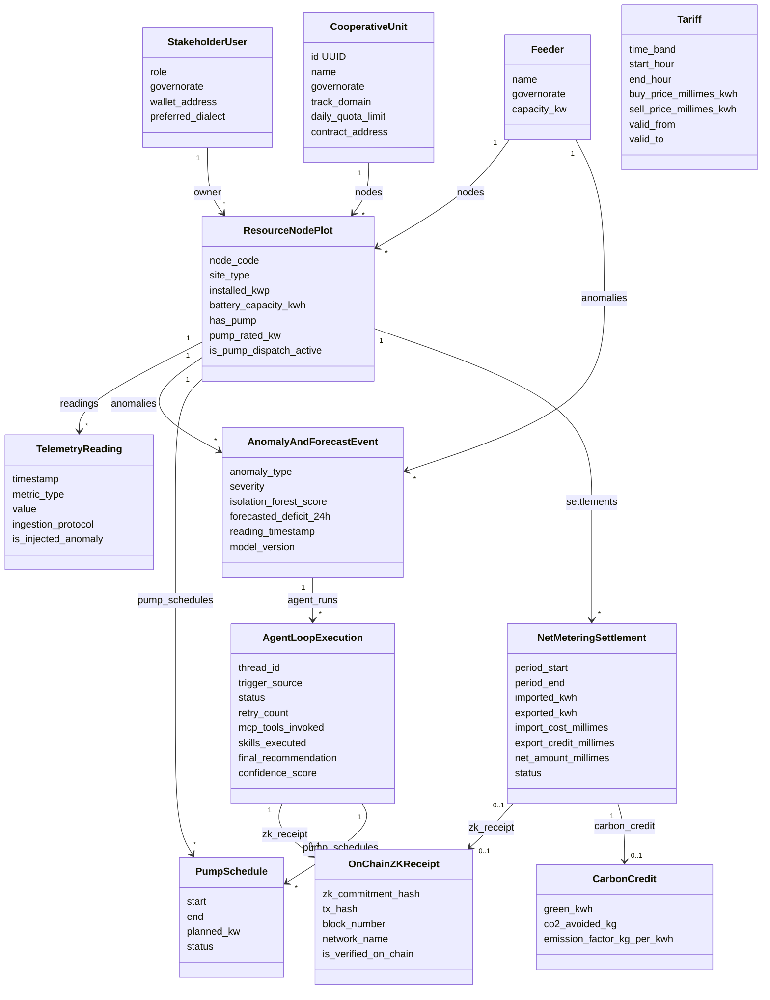

# Contrat des modèles : SolarSouk-STEG (Track 7)

Référence unique, alignée sur `backend/tunisovereign_core/models.py`.
**Règle : on modifie ce fichier d'abord, on prévient le groupe, puis on modifie `models.py`.**

## Conventions

- **Une seule app Django** : `tunisovereign_core`. Toutes les classes sont dans `models.py`.
- `AUTH_USER_MODEL = "tunisovereign_core.StakeholderUser"`.
- Noms en anglais, `snake_case`. Les noms de classes du sujet sont conservés pour que l'UML corresponde au code.
- Chaque énumération est un `TextChoices`. Chaque modèle a un `__str__`.
- Argent en **millimes** (entiers). Horodatages en **UTC** (`USE_TZ = True`).
- Unités de télémétrie : kW, %, V.
- Une ligne de `TelemetryReading` = une mesure, comme un paquet du `.proto` (`node_code`, `metric_type`, `value`, `iso_timestamp`).

## Énumération partagée

`Governorate` : `TOZEUR`, `KEBILI`, `TATAOUINE`, `SFAX`.

## Modèles

### Utilisateurs

| Modèle | Champs |
|---|---|
| `StakeholderUser` (hérite d'`AbstractUser`) | `role` (`Role`, défaut `COOP_MEMBER`), `governorate` (`Governorate`, index), `wallet_address` (Char 42, null), `preferred_dialect` (Char 16, défaut `ar-TN`) |

`Role` : `COOP_MEMBER` (ferme ou PME productrice), `REGIONAL_AUDITOR` (auditeur énergie régional), `NATIONAL_ADMIN`, `AGENT_SERVICE` (agent IA et compte MCP).

### Réseau

| Modèle | Champs | Contraintes |
|---|---|---|
| `Feeder` | `name` (unique), `governorate`, `capacity_kw`, `created_at` | `capacity_kw > 0` |
| `CooperativeUnit` | `id` (UUID, pk), `name`, `governorate`, `track_domain` (Char 64, défaut `Track_07_SolarSouk_STEG`), `daily_quota_limit` (kWh/jour), `contract_address` (Char 42, blank), `created_at` | |
| `ResourceNodePlot` (site solaire) | `coop` (FK, `related_name="nodes"`), `owner` (FK utilisateur, `related_name="owned_nodes"`), `feeder` (FK, PROTECT, `related_name="nodes"`), `node_code` (unique, ex. `TOZ-001`), `site_type` (`FARM` ou `SME`), `installed_kwp`, `battery_capacity_kwh`, `has_pump`, `pump_rated_kw`, `is_pump_dispatch_active`, `created_at` | `pump_rated_kw = 0` si `has_pump = False` |
| `Tariff` | `name`, `time_band` (`OFFPEAK`, `DAY`, `PEAK`), `start_hour` (0-23), `end_hour` (0-24), `buy_price_millimes_kwh`, `sell_price_millimes_kwh`, `valid_from`, `valid_to` (null), `created_at` | `valid_to >= valid_from` |

Une tranche horaire peut passer minuit (`OFFPEAK` : 22 à 6). Le calcul de facture doit gérer ce cas.

### Télémétrie

| Modèle | Champs | Index |
|---|---|---|
| `TelemetryReading` | `node` (FK, `related_name="readings"`), `timestamp` (UTC, index), `metric_type`, `value` (Float), `ingestion_protocol` (`REST`, `GRPC`, `GRAPHQL`, défaut `GRPC`), `is_injected_anomaly` (Bool, défaut False) | `(node, metric_type, -timestamp)` et `(timestamp, metric_type)` |

`metric_type` :

| Valeur | Sens |
|---|---|
| `GENERATION_KW` | Production solaire (kW) |
| `BATTERY_SOC` | État de charge de la batterie (%) |
| `PUMP_LOAD_KW` | Charge de la pompe (kW) |
| `VOLTAGE_V` | Tension de l'onduleur (V) |
| `GRID_NET_KW` | Puissance réseau : **positif = import, négatif = export** |

La **charge d'un feeder** n'est pas stockée : on la calcule en sommant la charge des nœuds rattachés (consommation moins production, par instant).

`is_injected_anomaly` est la vérité terrain du simulateur. Elle sert uniquement à calculer Précision, Rappel et F1. **Le modèle ML ne doit jamais la lire comme variable d'entrée.**

### ML, agent et blockchain

| Modèle | Champs | Contraintes et index |
|---|---|---|
| `AnomalyAndForecastEvent` | `node` (FK, null), `feeder` (FK, null), `reading_timestamp` (null), `detected_at` (auto), `anomaly_type`, `severity`, `isolation_forest_score` (null, voir 0002), `forecasted_deficit_24h` (kWh), `model_version` (défaut `isoforest-v1`) | au moins un de `node` ou `feeder` ; index `(severity, -detected_at)` |
| `AgentLoopExecution` | `thread_id` (index), `trigger_source`, `anomaly` (FK, null, SET_NULL), `status`, `retry_count`, `darja_transcript`, `parsed_intent_json`, `mcp_tools_invoked` (liste JSON), `skills_executed` (liste JSON), `final_recommendation`, `confidence_score` (0 à 1), `created_at` | |
| `OnChainZKReceipt` | `agent_execution` (OneToOne, `related_name="zk_receipt"`), `zk_commitment_hash` (unique, 66), `public_inputs_json`, `tx_hash` (unique, 66), `block_number`, `network_name` (défaut `Foundry-Anvil-Local`), `is_verified_on_chain` (défaut False, voir 0002), `created_at` | |

- `Severity` : `LOW`, `MEDIUM`, `CRITICAL`.
- `AnomalyType` : `FEEDER_OVERLOAD`, `VOLTAGE_OUT_OF_RANGE`, `INVERTER_FAILURE`, `PUMP_MISALIGNED`, `SOC_INCONSISTENT`.
- `Status` (agent) : `RUNNING`, `COMPLETED`, `ESCALATED`, `FAILED`.
- La surcharge d'un feeder est une anomalie **de niveau feeder** : on renseigne `feeder`, `node` reste vide.
- `AgentLoopExecution` est créé en `RUNNING` au début d'un passage, puis complété. C'est pourquoi `final_recommendation` accepte d'être vide.

## Diagramme de classes (Mermaid)

`Tariff` n'a pas de relation : il est consulté par le calcul de facture selon l'heure et la date.

## Seuils du Track 7 (simulateur et ML)

- Tension normale : **220 V ± 6 %**, soit 206,8 à 233,2 V.
- Pompes alignées sur le pic solaire : **10h à 15h**.
- Anomalie critique : charge du feeder **> 92 %** de `capacity_kw`, en soirée à faible irradiation.

## Données de seed (hypothèses à valider par les Membres 1 et 4)

- 4 feeders, un par gouvernorat. Leur capacité doit être calibrée de façon qu'un démarrage simultané des pompes en soirée dépasse 92 %, sinon l'anomalie principale n'apparaîtra jamais.
- 1 coopérative par gouvernorat, environ 10 nœuds au total, 2 à 3 par feeder, `node_code` de la forme `TOZ-001`, `KEB-001`, `TAT-001`, `SFX-001`.
- 3 tarifs **illustratifs** (millimes/kWh). Ce ne sont pas des tarifs STEG officiels : à remplacer par des valeurs sourcées dans le README.

| Tranche | Heures | Achat | Rachat |
|---|---|---|---|
| `OFFPEAK` | 22 à 6 | 150 | 100 |
| `DAY` | 6 à 18 | 200 | 130 |
| `PEAK` | 18 à 22 | 300 | 160 |

- Le facteur d'émission du réseau tunisien (pour les crédits carbone) est une variable d'environnement, avec sa source citée dans le README.

## Migration 0002 (Rôle 1)

Une seule migration regroupe tous les changements ci-dessous, pour que personne n'ait à refaire sa base deux fois. Ne renommez pas les modèles existants.

### Changements sur des modèles existants

| Modèle | Champ | Avant | Après |
|---|---|---|---|
| `AnomalyAndForecastEvent` | `isolation_forest_score` | obligatoire | `null=True, blank=True` : la règle déterministe FEEDER_OVERLOAD (> 92 %) n'a pas de score IsolationForest |
| `OnChainZKReceipt` | `is_verified_on_chain` | défaut `True` | défaut `False` : un reçu n'est « vérifié » qu'après confirmation du contrat |

Les types d'anomalie de nœud (`VOLTAGE_OUT_OF_RANGE`, `INVERTER_FAILURE`, `PUMP_MISALIGNED`, `SOC_INCONSISTENT`) et les sévérités existent déjà : aucun nouveau choix n'est ajouté.

### Nouveaux modèles

| Modèle | Champs | Contraintes et index |
|---|---|---|
| `PumpSchedule` (planning proposé par l'agent) | `node` (FK, CASCADE, `related_name="pump_schedules"`), `agent_execution` (FK, null, SET_NULL, `related_name="pump_schedules"`), `start` (UTC), `end` (UTC), `planned_kw` (Float), `status` (`PROPOSED`, `APPLIED`, `CANCELLED`, défaut `PROPOSED`), `created_at` | `end > start` ; `planned_kw >= 0` ; index `(node, start)` |
| `NetMeteringSettlement` (règlement d'un nœud sur une période) | `node` (FK, PROTECT, `related_name="settlements"`), `period_start` (UTC), `period_end` (UTC), `imported_kwh`, `exported_kwh` (Float >= 0), `import_cost_millimes`, `export_credit_millimes` (entiers >= 0), `net_amount_millimes` (entier signé), `status` (`PENDING`, `SETTLED`, `FAILED`, défaut `PENDING`), `zk_receipt` (OneToOne vers `OnChainZKReceipt`, null, SET_NULL, `related_name="settlement"`), `created_at` | `period_end > period_start` ; unique `(node, period_start, period_end)` ; `net_amount_millimes = import_cost_millimes - export_credit_millimes` |
| `CarbonCredit` (lié à un règlement) | `settlement` (OneToOne, PROTECT, `related_name="carbon_credit"`), `green_kwh` (Float >= 0), `co2_avoided_kg` (Float >= 0), `emission_factor_kg_per_kwh` (Float > 0, facteur utilisé), `created_at` | |

Conventions :

- `net_amount_millimes` > 0 : le nœud paie ; < 0 : le réseau paie le nœud (cohérent avec GRID_NET_KW : positif = import).
- `emission_factor_kg_per_kwh` est copié dans la ligne au moment du calcul : le crédit reste reproductible même si la variable d'environnement change ensuite.
- La coopérative et la période d'un crédit se retrouvent par `settlement.node.coop` et `settlement.period_*`. Le reçu on-chain d'un crédit se retrouve par `settlement.zk_receipt`.
- Le unique `(node, period_start, period_end)` rend le règlement idempotent : un nouvel essai de l'agent ne crée pas de doublon.

### Limite connue

`OnChainZKReceipt.agent_execution` est un OneToOne : **un passage d'agent produit au plus un reçu, donc un règlement on-chain.** Régler plusieurs nœuds demande plusieurs passages. On ne change pas ce lien pour ne pas casser `execution.zk_receipt` côté dashboard.

### Correspondance contrats d'interface et champs

| Dictionnaire | Champ |
|---|---|
| `forecast_peak_load` : `forecasted_deficit_24h_kwh` | `AnomalyAndForecastEvent.forecasted_deficit_24h` |
| `optimize_pump_schedule` : `schedules[].node_code`, `start`, `end`, `planned_kw` | `PumpSchedule.node` (via `node_code`), `start`, `end`, `planned_kw` |
| `prove_green_origin` : `commitment_hash`, `public_inputs` | `OnChainZKReceipt.zk_commitment_hash`, `public_inputs_json` |
| `settle_on_chain` : `tx_hash`, `block_number`, `network_name`, `is_verified` | `OnChainZKReceipt.tx_hash`, `block_number`, `network_name`, `is_verified_on_chain` |

### À confirmer par le groupe : qui écrit quoi

Proposition (non encore validée) : le Rôle 2 fournit le calcul du règlement (`billing.py`), le Rôle 5 fournit le calcul du CO2 évité (facteur lu dans `.env`), et le Rôle 4 (agent) écrit en base `NetMeteringSettlement`, `CarbonCredit` et `OnChainZKReceipt`. Les signatures de ces deux fonctions de calcul sont à fixer entre les rôles concernés.

## Anciens noms du starter (Track 1) vers le Track 7

| Ancien | Nouveau |
|---|---|
| `MetricType` : `MOISTURE`, `FLOW`, `TEMP`, `STOCK` | `GENERATION_KW`, `BATTERY_SOC`, `PUMP_LOAD_KW`, `VOLTAGE_V`, `GRID_NET_KW` |
| `crop_or_sector_type` | `site_type` (`FARM` ou `SME`) |
| `allocated_share_pct` | supprimé |
| `is_valve_or_dispatch_active` | `is_pump_dispatch_active` |
| `governorate` (texte libre) | `Governorate` (`TextChoices`) |
| `ingestion_protocol = "gRPC"` | `GRPC` (`TextChoices`) |
| `AnomalyAndForecastEvent.node` obligatoire | `node` ou `feeder` (au moins un) |
| `CooperativeUnit.track_domain` = `Track_01_Water_Agri` | conservé, défaut `Track_07_SolarSouk_STEG` |
| `Feeder`, `Tariff` | nouveaux modèles |